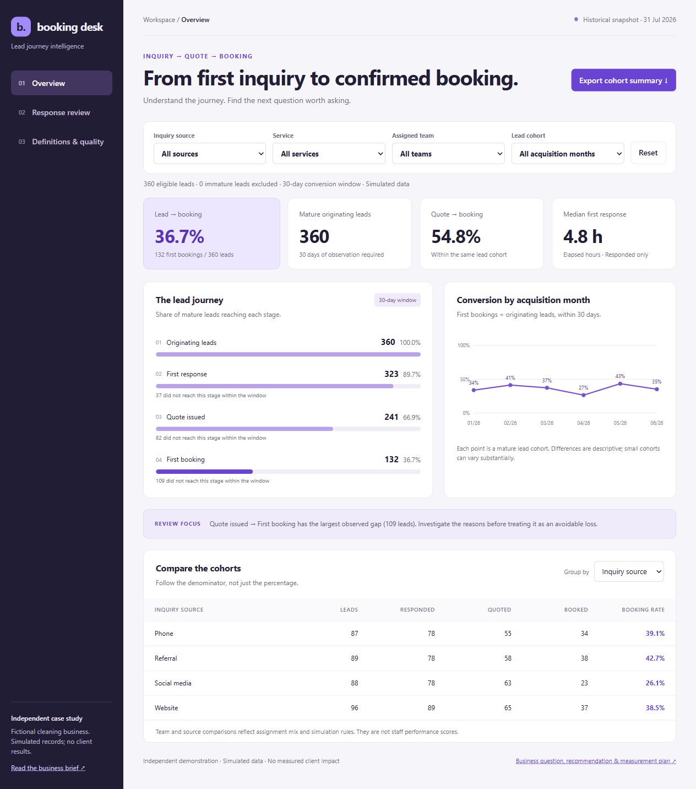

# Lead-to-Booking Improvement

**Independent business analysis and data analysis case study**

A fictional cleaning business needs a consistent way to manage inquiries, follow-up, quotes, and bookings. This project combines a relational SQL investigation with process maps, prioritized requirements, acceptance tests, and an interactive dashboard.



## Disclosure
All records are simulated using the included deterministic generator. The company, stakeholder roles, business problem, and process descriptions are scenario assumptions. No customer interviews, paid client work, or measured improvements are claimed. Results describe the generated dataset, not the cleaning industry. Outcomes are simulated independently of response delay; the analysis cannot estimate the causal effect of faster responses.

## Start here
- Open `reports/dashboard.html` in a browser; it works offline.
- Read `reports/executive-brief.md` for the computed findings and proposed actions.
- Read `docs/business-analysis.md` for the brief, process maps, requirements, and UAT scenarios.
- Inspect `sql/funnel.sql` and `src/analyze.py` for the data model and analytical logic.
- Read `docs/data-dictionary.md` for grain, definitions, and the attribution/maturity policy.

## Booking Desk workspace
The dashboard uses a distinct sidebar workspace with Overview, Response Review, and Definitions & Quality views. Cohort filters are shared across the views.

- Monthly booking-rate trend with cohort counts in point tooltips.
- Separate all/unanswered/late review categories and search by lead ID, source, service, or team.
- Ten-record pagination, so every matching exception remains accessible.
- Lead journey dialog showing inquiry, first response, first quote, and first booking timestamps.
- Filtered cohort summary and complete matching review-list CSV exports, with filter context.
- Validated response threshold; changing it reclassifies history without forecasting conversion uplift.

The response list and journey are historical analysis features. They do not implement assignment changes, reminders, or customer communication. The trend uses a fixed 0–100% scale and counts bookings within the same 30-day cohort definition as SQL.

## Business analysis handoff
- `docs/discovery-and-decisions.md`: nine pending discovery questions, six assumptions, and six documented design decisions. No interviews or client approvals are claimed.
- `docs/implementation-backlog.md`: eight prioritized user stories with dependencies, acceptance criteria, traceability, and implementation status.
- `docs/sql-walkthrough.md`: Mermaid entity diagram and explanation of joins, cohort windows, denominators, and window ranking.
- `.github/workflows/analysis-checks.yml`: GitHub Actions configured for pushes and pull requests; runs tests, verifies deterministic source regeneration, and validates reports on Python 3.10 and 3.12.

Eleven automated tests include invalid booking/quote linkage and exact 30-day cutoff boundaries. Local checks have been run. See the GitHub Actions link for the current remote workflow status. Workflow actions follow the official [checkout](https://github.com/actions/checkout) and [setup-python](https://github.com/actions/setup-python) documentation.

## Reproduce
Python 3.10+; no additional packages required. From this folder:

```sh
python src/generate_data.py
python src/analyze.py
python -m unittest discover -s tests -v
```

The first command recreates the simulated CSV files, the second recreates the reports. Generated data is included so the project can be inspected immediately. The local SQLite database is a disposable intermediate and is excluded from version control. The dashboard uses one row per lead derived from the source tables.

## Business questions
1. What proportion of originating leads receives a response, a quote, and a booking within 30 days?
2. Where do the largest observed stage gaps occur?
3. How do conversion and response measures differ by source, service, owner, and acquisition month?
4. Which leads lack a recorded response or exceed a proposed response threshold?
5. What process change could be tested, and how would its value be evaluated?

## Scope and limits
This is a lead-to-first-booking workflow, not customer scheduling or service delivery. A booking is not completed work, collected revenue, or profit. No demographic or personal contact information is included. Response time uses elapsed clock hours, not staffed business hours. Source attribution is the recorded inquiry source, not multi-touch marketing attribution. Owner comparisons are descriptive and should not be used to assess individual staff performance without controlling for assignment and workload.

The default four-hour response threshold is a proposed demonstration setting, not an agreed client SLA. The dashboard changes historical counts against that threshold; it does not forecast improved conversion or savings.

## Project links
- [Open Booking Desk](https://himu1221.github.io/projects/booking-desk/dashboard.html)
- [Portfolio](https://himu1221.github.io/#work)
- [Source repository](https://github.com/Himu1221/lead-to-booking-analysis)
- [GitHub Actions checks](https://github.com/Himu1221/lead-to-booking-analysis/actions/workflows/analysis-checks.yml)

Independent demonstration using simulated data. LinkedIn copy remains a draft; no LinkedIn post has been published.
