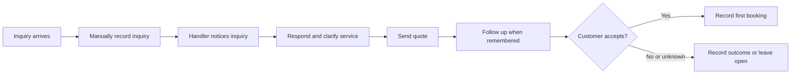
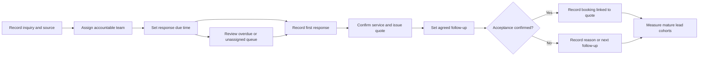

# Business analysis package

## Brief and assumed stakeholders
Scenario: a fictional residential cleaning business receives inquiries through phone, website, referrals, and social media. Assume a shared spreadsheet and ad hoc follow-up for the current process; this has not been observed in a real business.

Objective: design a measurable lead-to-first-booking workflow with clear ownership and contact history. Scope includes inquiries, responses, quotes, reminders, and conversion reporting. Service scheduling, invoicing, customer authentication, and delivery operations are excluded.

| Assumed role | Need to validate | Discovery question |
|---|---|---|
| Owner | Visibility into inquiry outcomes | Which decisions would change based on this report? |
| Inquiry handler | Clear ownership and follow-up | Where do inquiries arrive, and what happens during absence or reassignment? |
| Service coordinator | Accurate booking handoff | What must be confirmed before a quote becomes a booking? |
| Data owner | Traceable and appropriate records | How are duplicates, timestamps, contact preferences, and retention handled? |

## Current process — hypothesis for validation

## Proposed process — subject to discovery and approval

## Prioritized requirements and traceability
Priorities are proposed for this case study, not negotiated with a stakeholder. The dashboard and analysis are implemented; the operational CRM features below remain proposed.

| ID | Priority | Requirement | Acceptance criterion | Evidence/status |
|---|---|---|---|---|
| R1 | Must | Preserve one record per originating lead in reporting | Adding follow-up activities must not change originating lead counts | SQL rollup; fan-out test |
| R2 | Must | Report a consistent conversion window | Exclude immature leads from conversion denominators and show exclusions | SQL mature flag; maturity test |
| R3 | Must | Distinguish missing response from late response | Nonresponders must not appear as zero-hour or late responded leads | Separate dashboard counts; missing-response test |
| R4 | Must | Track quote-to-booking lineage | Each booking references a quote belonging to the same lead and occurs afterward | Input sequence and key validation |
| R5 | Should | Explore source, service, owner, and cohort | All dashboard metrics and tables reflect the selected originating leads | Interactive report |
| R6 | Should | Apply an agreed response target | Changing the demonstration threshold updates late counts without claiming conversion uplift | Dashboard threshold; proposed production SLA |
| R7 | Must | Assign and reassign inquiry ownership with history | Production system records who changed ownership, when, and why | Proposed CRM feature; not implemented |
| R8 | Should | Remind handlers about agreed follow-up | Production system shows due/overdue follow-up without contacting customers automatically | Proposed CRM feature; not implemented |

## User stories and UAT scenarios
**Owner story:** As an owner, I want cohort-based conversion reporting so I can distinguish inquiry volume from booking progression.

- UAT-01: Given two follow-ups for an existing lead, when the data is refreshed, then originating lead counts and booking counts remain unchanged.
- UAT-02: Given a lead created fewer than 30 days before the snapshot, when conversion is calculated, then that lead is excluded and its exclusion is visible.
- UAT-03: Given a lead without a response, when response measures are calculated, then its duration is blank and it appears in the no-response count.
- UAT-04: Given a first response after five elapsed hours, when the demonstration target changes from four to eight hours, then it stops counting as late, while booking conversion remains unchanged.
- UAT-05: Given a booking with a quote from a different lead, when source validation runs, then refresh fails and an error is recorded.

**Handler story (proposed operational feature):** As an inquiry handler, I want a due-follow-up queue so I can manage agreed next actions. Validate staffing and contact preferences before deciding reminder timing.

## Evaluation and rollout
Validate the assumed process through real interviews before recommending implementation. Pilot definitions and queue ownership with one team, reconcile records, and train users. Agree baseline windows, comparison groups where feasible, success thresholds, and stop criteria before a reminder test. Monitor conversion, response coverage, response time, staff workload, duplicate inquiries, and completed-service quality. No benefit realization is claimed.
