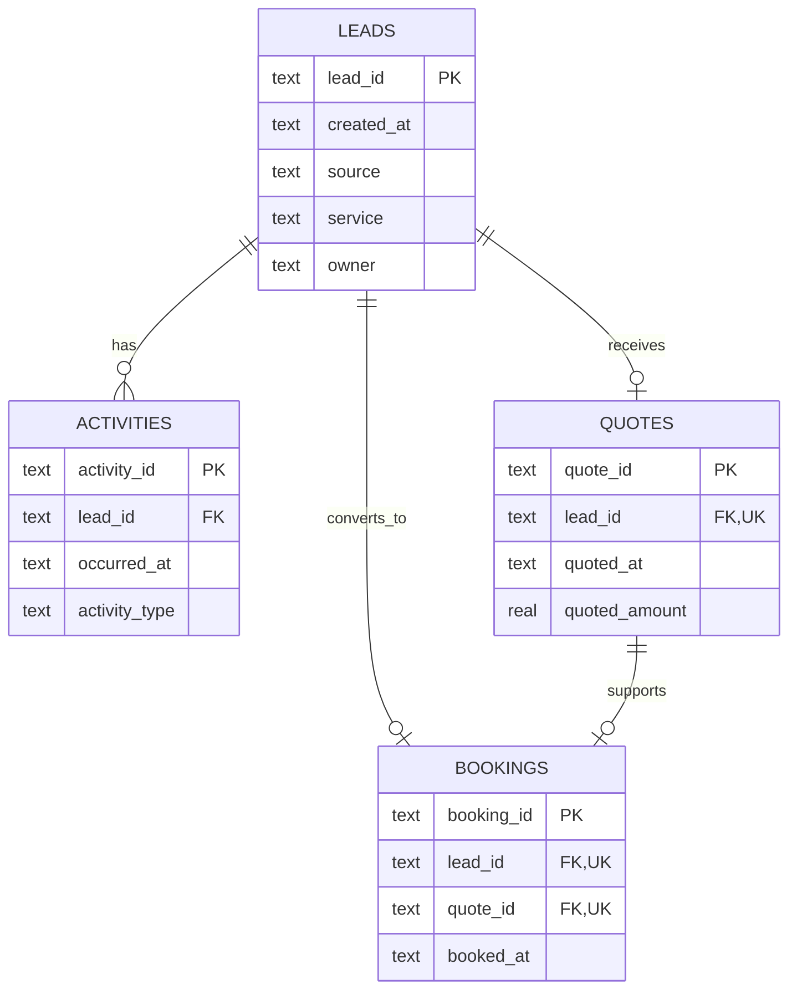

# Relational model and SQL walkthrough

## Data model

Source grain and uniqueness are enforced in `src/analyze.py`. There may be many activities per lead; there is at most one quote and one first booking per lead in this version. A booking must reference a quote for the same lead. Separate foreign keys alone cannot enforce that cross-relationship rule, so validation checks it explicitly. Quote revisions, customers, repeat bookings, cancellations, and service completion need additional modeling.

## Step 1: roll up the many-side tables
The response CTE filters `activity_type='First response'` and finds its earliest timestamp for each lead. Follow-up activity cannot reset that timestamp. Quote and booking CTEs also yield one row per lead.

Why: if one lead has three activities and one booking, directly joining the raw tables yields three rows with the same booking. A plain row count or sum would overstate the funnel. Pre-aggregation preserves the intended grain. `COUNT(DISTINCT lead_id)` alone would not protect every other summed measure against this fan-out.

## Step 2: preserve nonresponders with LEFT JOIN
Join the rolled-up CTEs back to leads with LEFT JOIN. Leads without events remain visible and their missing timestamps remain NULL. An inner join would remove nonresponders and bias conversion and response coverage upward.

## Step 3: calculate elapsed time and maturity
`(julianday(first_response)-julianday(created_at))*24` gives elapsed hours. It is not staffed business time. Maturity requires at least 30 elapsed days between lead creation and the fixed snapshot. `:snapshot` is a bound SQL parameter so the result is reproducible and does not depend on the computer's current date.

## Step 4: enforce the stage window
The responded, quoted, and booked flags each require an event between zero and 30 elapsed days after creation, inclusive. Events at exactly the cutoff count; events one second later do not. Creation month determines cohort membership, even if the booking occurs the following month. Immature leads remain in the derived dataset but are excluded from conversion denominators.

## Step 5: aggregate the correct denominator
`source_performance.sql` groups only mature leads. Lead-to-booking is booked / originating leads; quote-to-booking is booked / quoted leads from that same cohort. The `1.0*` expression avoids integer division and `NULLIF` protects an empty denominator. Do not average subgroup percentages when recomputing an overall conversion rate.

## Step 6: use a window rank carefully
`DENSE_RANK` ranks grouped source conversion rates and preserves ties. The ranking is descriptive, not a recommendation to reallocate marketing spend. Counts must accompany percentages, source differences are partly generated by simulation rules, and there is no spend or causal experiment in this data.

## Checks and interview example
The current run reconciles 360 originating leads to 132 first bookings in the 30-day window. Eleven automated tests cover fan-out, unanswered leads, maturity, threshold invariance, late booking exclusion, exact second-level cutoff boundaries, and invalid quote/lead links. See `tests/test_analysis.py` and the README for the run command.

Explain in an interview: “I first established a lead-level grain, rolled up event tables, retained unanswered leads with LEFT JOIN, and aligned numerator and denominator to a mature originating cohort. I treated missing timestamps and proposed operational rules explicitly rather than presenting a simulated dashboard as a live CRM.”
